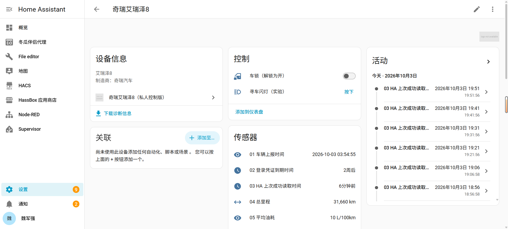
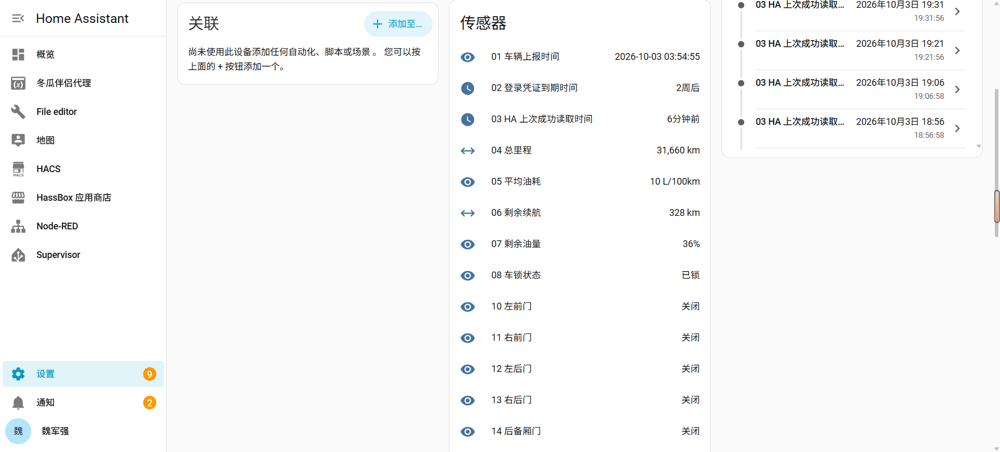
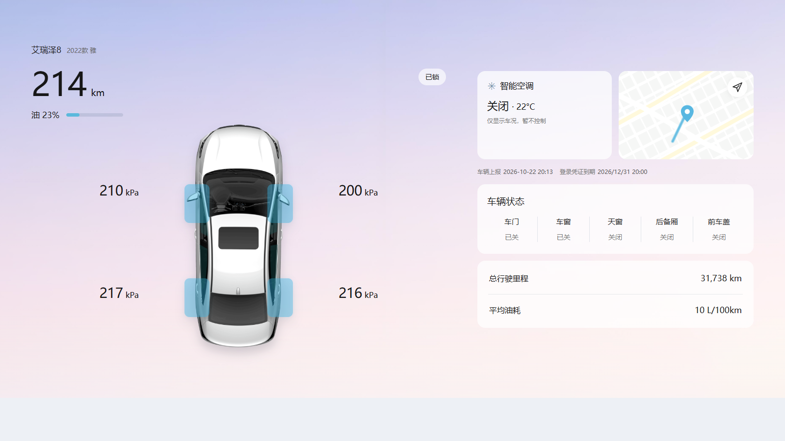

# 奇瑞艾瑞泽8 Home Assistant 车况集成

将国内版「奇瑞汽车」App 中的艾瑞泽8车况接入 Home Assistant。当前已在 **2022 款艾瑞泽8雅**上验证，集成只读取车况，不发送车辆控制命令。

## 在 Home Assistant 中的效果

下面两张截图分别展示设备概览和更多车况传感器，包括读取时间、里程、续航和油量。截图来自用户的 HA 环境，其中的车锁和寻车灯控件属于实验版本，当前发布版不提供车辆控制；数值仅为截图时的车辆状态。

公开版还提供可选的俯视车况卡片，使用白色 2022 款艾瑞泽8雅的图片。卡片只显示车辆状态，不提供远程控制。

[查看手机布局和安装步骤](CARD.md)。图片来自奇瑞汽车 App，权利归原权利人所有；本项目与奇瑞汽车无官方关联。

## 下载与安装

从 [Releases](https://github.com/cumtwjq/chery-arrizo8-ha/releases/latest) 下载：

- `chery_arrizo8-experimental.zip`：Home Assistant 集成安装包。
- `arrizo8-local-capture.zip`：Windows 本地抓取工具，内置 Python 和 mitmproxy，电脑无需另装 Python。
- `arrizo8-dashboard-card.zip`：可选俯视车况卡片及所需图片；集成安装包也已包含相同文件。

按照[安装说明](INSTALL.md)把集成目录上传到 HA。首次配置需要用[本地抓取工具](local_tool/本地抓取说明.md)从自己的「奇瑞汽车」App 获取一份已签名的只读车况请求。现在可另填 App 刷新凭证，启用 HA 内自动换取车况令牌；以后可在集成「配置」中单独更新任一项。旧版只填写车况请求的方式继续可用。

## 可查看的车况

总里程、平均油耗、剩余续航、剩余油量、车辆位置、车锁、车门、车窗、天窗、后备厢、机盖、发动机、空调状态、左右空调温度及胎压。具体实体以车辆接口实际返回的字段为准。位置按高德 GCJ‑02 坐标校准；可以使用[俯视车况卡片](CARD.md)或[HA 自带卡片示例](DASHBOARD.md)。

设备页最前面显示**车辆上报时间**、**登录凭证到期时间**和 **HA 上次成功读取时间**，方便判断车况是否过时。HA 约每 30 分钟读取一次；填写 App 刷新凭证后会定期换取新的车况令牌，并在服务器返回轮换凭证时保存新值。未填写 App 凭证时，车况令牌到期前 48 小时仍会在「修复」中提醒。

## 当前限制

- HA 内不保存手机号和密码。Windows 实验工具可从车主自己提供的官方 APK 登录并取得 App 刷新凭证；使用同一账号时可能让手机 App 退出登录。该通用工具的自动生成设备标识尚未经过其他车主的在线验证；登录失败时仍可通过 iPhone 抓包取得凭证。App 刷新凭证的长期续期结果取决于奇瑞服务器，不能保证永久有效。
- 已签名车况请求仍需首次抓取。HA 只替换请求中的访问令牌，不重新计算 `sign`；若服务端以后拒绝旧签名，需要重新抓取完整车况请求。
- 不支持开锁、启动、空调等远程控制。车主已对照验证常用状态，已确认的车窗通风、完全开启和天窗翘起仍显示细分名称。其他有效数字状态码默认显示为开启（车锁为已解锁、发动机为运行）；这是显示规则，并非所有代码都已实测。缺失或非数字值仍显示为未知。
- HA 主机需要能够访问 `cloudrivechery.mychery.com:443`。车辆上报时间取自服务端车况，可能早于 HA 读取时间。

抓取工具在车主电脑上用 Windows DPAPI 加密保存请求；手动导入后，HA 也会在本机配置中保存请求和 App 刷新凭证。仓库和下载包不包含车主的令牌、VIN、位置、APK 或抓包数据。请勿公开分享导出的请求 JSON 和刷新凭证。

## 鸣谢

感谢 **Codex** 协助开发、测试和整理本集成；感谢车主提供实际车况验证。
